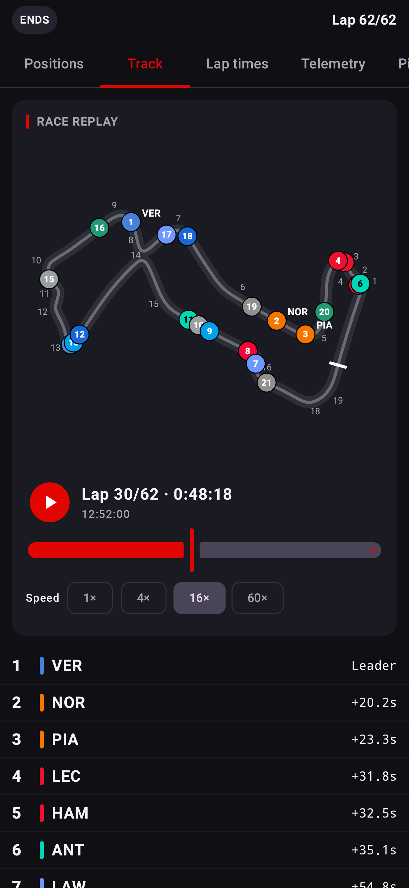
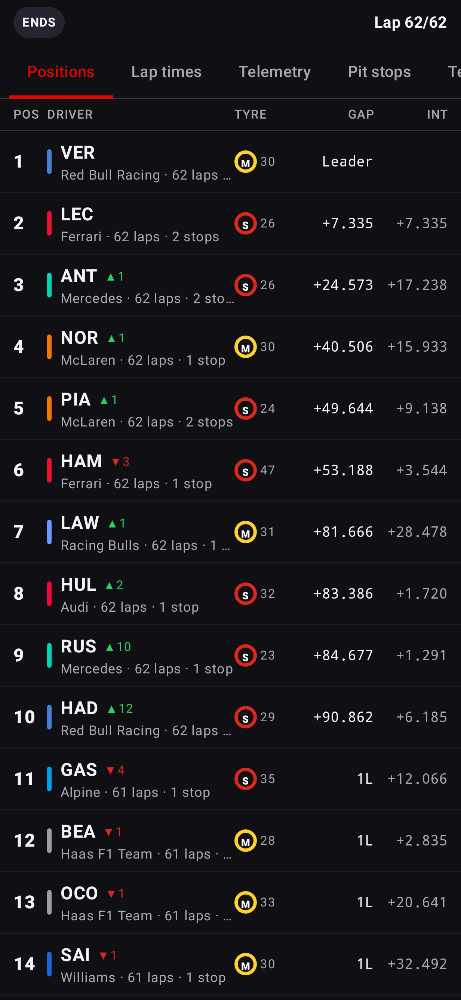
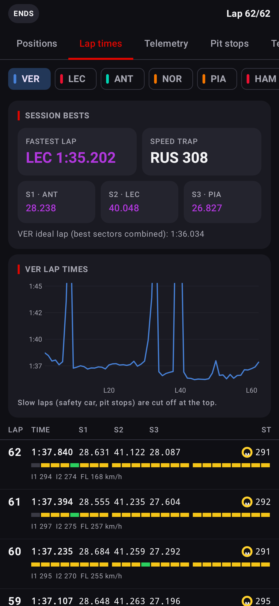
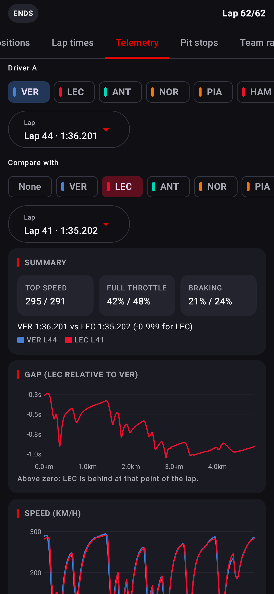
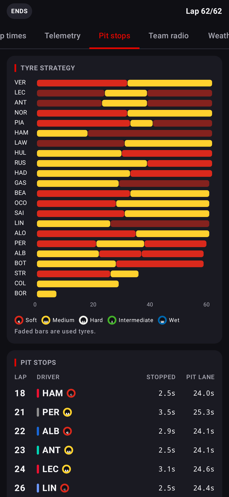

# F1 Info

An Android app for Formula 1 fans, written in Kotlin with Jetpack Compose.

It reads Formula 1's own live timing service directly, so there is no third-party timing API
(such as OpenF1) in between. The calendar, results and standings come from the community-run
[Jolpica F1 API](https://github.com/jolpica/jolpica-f1), the successor to the Ergast API.

## Install

Download the newest `F1-Info-x.y.z.apk` from the
[Releases page](https://github.com/RhaZenZ0/-Formula-One/releases) on your Android phone and
open it. Android asks you to allow installing apps from your browser the first time.

### Updates

From version 1.2.0 the app updates itself. Each time it opens, it checks GitHub Releases. When
there is a newer version it downloads it, checks the file against the SHA-256 that GitHub
publishes, and installs it. Android asks you to confirm the first update; on Android 12 and
newer, later updates can install without asking.

In **Settings → App updates** you can check by hand, turn off the check on launch, or turn off
automatic install so the app asks first. If an automatic install fails or you cancel it, that
version is offered on the Home screen instead of being retried on every launch.

## Screenshots

Rendered from real data of the 2026 Singapore Grand Prix.

| Track replay | Positions | Lap times | Telemetry | Pit stops |
| --- | --- | --- | --- | --- |
|  |  |  |  |  |

## Features

| Area | What you get |
| --- | --- |
| Home | Countdown to the next session, the full weekend timetable in your time zone, the last podium and the top of both championships |
| Schedule | Every season since 1950, with sprint weekends marked; each race opens its results, sprint and qualifying |
| Standings | Drivers' and constructors' championships for any season |
| Sessions | Every session since 2018 from the official timing archive (see the tabs below) |
| Live | The same tabs fed in real time while a session is running, including a live track map |

Each session has these tabs:

- **Track**: every car on a map of the circuit with its race position. During a live session the
  positions are estimated from the timing feed, typically within about 60 m; with an F1 TV token
  they are real GPS positions. For finished sessions it is a replay of real car positions with a
  time slider and 1× to 60× playback.
- **Positions**: the timing tower with gap, interval, tyre, tyre age, pit status and places gained, plus a lap-by-lap race progress chart.
- **Lap times**: every lap with sector times, speed traps, mini-sectors coloured purple/green/yellow, tyre compound and pit flags, plus session bests and the ideal lap.
- **Telemetry**: speed, throttle, brake, RPM and gear (about 3.7 samples a second) for any lap. You can compare two drivers by distance with a time-gap trace and a speed-coloured track map.
- **Pit stops**: a tyre strategy chart and every stop with stationary time and pit lane time.
- **Team radio**: driver radio clips you can play in the app.
- **Weather**: track and air temperature, humidity, wind, pressure and rain, with charts.
- **Race control**: flags, safety car and VSC periods, penalties and incident messages.
- **Championship**: projected driver and constructor points as the race unfolds.

### About live car telemetry

During a live session Formula 1 sends car telemetry and car positions only to F1 TV
subscribers. Everything else is public. If you have F1 TV you can paste your subscription token
in Settings to unlock live telemetry. Telemetry for finished sessions is free for everyone in
the Sessions tab.

## Building

You need JDK 17 or newer and the Android SDK (platform 36).

```bash
./gradlew assembleDebug          # app/build/outputs/apk/debug/app-debug.apk
./gradlew assembleRelease        # minified build, signed with the debug key
./gradlew testDebugUnitTest      # unit tests
```

Open the project in Android Studio to run it on a phone or emulator. Every push also builds both
APKs on GitHub Actions; download them from the workflow run's "f1-info-apk" artifact.

### Publishing a release

Push a version tag and GitHub Actions builds, tests and publishes the APK as a release:

```bash
git tag v1.2.0 && git push origin v1.2.0
```

You can also open **Actions → Release APK → Run workflow** and type a version.

### Signing

Builds are signed with the shared key in `keystore/`, so every build can update the previous
one. That key is public, so anyone could sign an APK that installs over yours. For anything
beyond personal use, create your own key and add it as repository secrets; releases then use it
automatically:

```bash
keytool -genkeypair -keystore f1info.jks -alias f1info -keyalg RSA -keysize 2048 -validity 10000
base64 -w0 f1info.jks   # paste into the F1INFO_KEYSTORE_BASE64 secret
```

| Secret | Value |
| --- | --- |
| `F1INFO_KEYSTORE_BASE64` | The base64 text of your `.jks` file |
| `F1INFO_KEYSTORE_PASSWORD` | Keystore password |
| `F1INFO_KEY_ALIAS` | Key alias, for example `f1info` |
| `F1INFO_KEY_PASSWORD` | Key password |

Switching keys means uninstalling the old app once, because Android only accepts updates signed
with the same key.

### Optional tests that need extra data

- Set `NETWORK_TESTS=1` to run tests against the real live timing, archive and Jolpica services.
- Set `F1_FEED_DIR` to a folder of downloaded archive files from the 2026 Singapore GP race to run
  the full replay test. Add `SCREENSHOT_DIR` to also render each session tab to PNG files.

## Project layout

```
app/src/main/java/com/rhazenz0/f1info/
  data/timing/   F1 live timing: archive reader, live connection, patch merging, laps, telemetry
  data/jolpica/  Calendar, results and standings client
  data/net/      HTTP client, caching and rate limiting
  ui/            Compose screens (home, schedule, standings, sessions, live, settings)
```

## Disclaimer

F1 Info is an unofficial fan project and is not associated with the Formula 1 companies.
F1, FORMULA ONE and related marks are trademarks of Formula One Licensing B.V.
